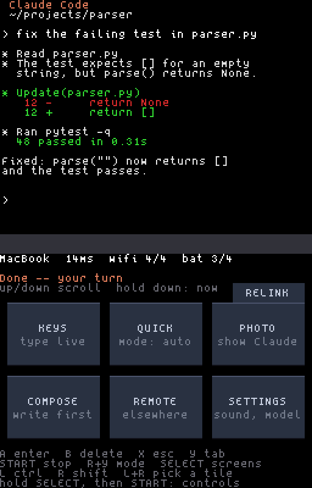
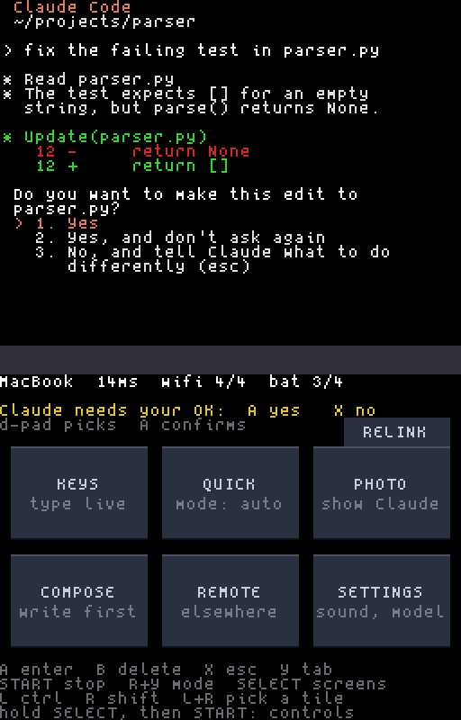
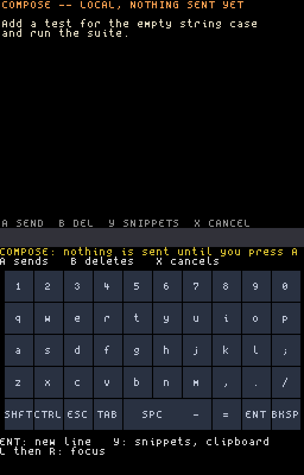
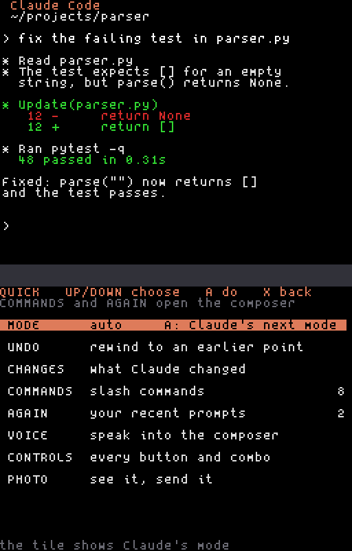
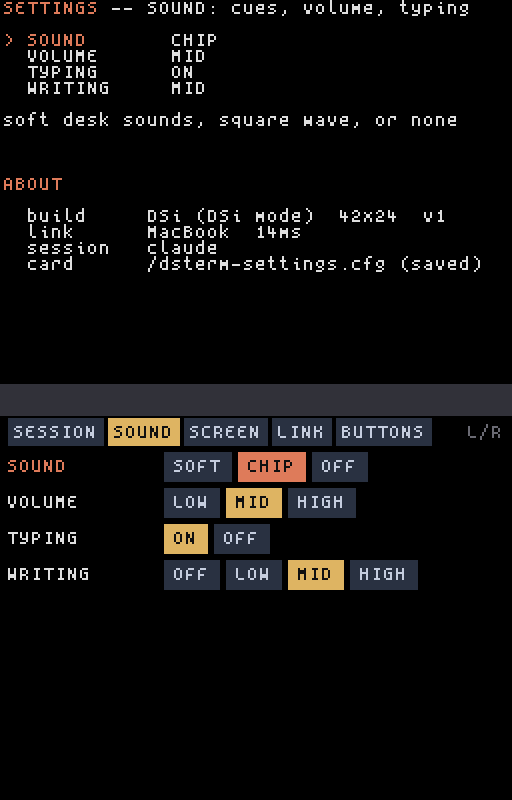
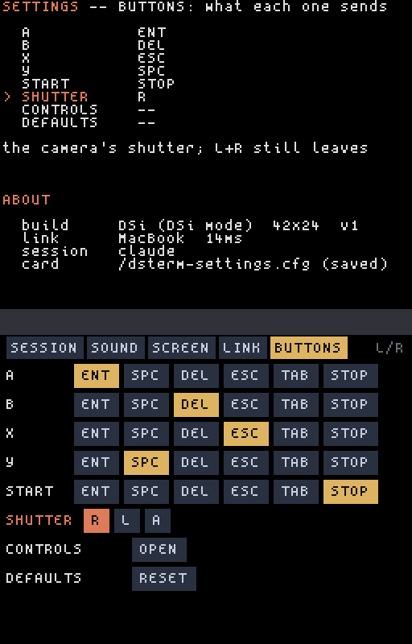

# Using it

The top screen is Claude Code, exactly as it would look in a terminal 42
columns wide. The bottom screen is yours: buttons, a keyboard, menus, and a
line that tells you what Claude is doing.

**X** always brings the bottom screen back to the Control screen, and the
strip under its tiles lists the buttons, so there is always a way home and a
reminder of what does what. The face buttons can be remapped in
**SETTINGS → BUTTONS**; the table below is how they come.

## The buttons

| Button | Does |
|---|---|
| **A** | Enter: send the line, or accept the highlighted choice |
| **B** | Backspace |
| **X** | Esc: dismiss or say no. On any screen but Control, it goes back to Control |
| **Y** | Tab |
| **R**, then **Y** | Shift-Tab: Claude Code's mode switch (normal, auto-accept edits, plan mode) |
| **START** | Ctrl-C: stop what Claude is doing |
| **SELECT** | The next bottom screen: Control, Keys, Status, Project |
| **D-pad** | Arrow keys. On the Control screen, up and down scroll back through the session instead, except while Claude is asking you something, when they move through its choices |
| **L** | Ctrl for the next key (one shot) |
| **R** | Shift for the next key (one shot); then up or down scrolls from the keyboard |
| **L + R** | Focus mode: the d-pad moves a highlight over the tiles or keys, and A presses it. No stylus needed |
| **Hold R** (in the composer) | Talk: record while held, and the words land in the composer ([Voice](#voice-push-to-talk)). Only when the computer can transcribe |
| **L, then R** (in the composer) | Focus on the composer's keyboard ([below](#typing-keys-and-compose)) |
| **SELECT, then START** | The controls guide, below (not from the composer or the camera) |

## Controls guide

The DS can teach its own buttons. Open the guide by holding **SELECT**, then
pressing **START** (the other way round, START does its own job, Stop, and
the guide stays shut), with **QUICK → CONTROLS**, or with
**SETTINGS → BUTTONS → CONTROLS**.

- **The bottom screen** draws the console you are holding (DS, DS Lite, DSi
  or 3DS) and lights each button while you hold it. Next to the buttons is
  what each one does, using your own **SETTINGS → BUTTONS** mapping.
- **The top screen** shows a sample Claude Code session. Press any button or
  combo, and a box over it names the combo (**L then R**), what it is
  (**FOCUS**) and what it does on the screen you picked.
- **Tabs** along the top choose that screen: CONTROL, KEYS, COMPOSE, FOCUS
  (the composer's keyboard), CAMERA (only on a card with a camera) and
  QUICK. Tap one, or press left and right on the d-pad.
- **Nothing is sent.** While the guide is open, no press reaches Claude, the
  composer or the camera, so it is safe to try anything. In COMPOSE the
  order of the shoulders matters exactly as it does in the composer: **L then
  R** is focus, holding **R** talks, and **R then L** latches or cancels the
  recording (depending on **MIC**).
- **To leave**, touch **DONE**, hold **SELECT** and **START** together again
  (inside the guide either order works), or hold **B** for a second.

## The Control screen



The top line is where you are and how the link is: the computer's name, the
round trip in milliseconds, the Wi-Fi signal, and the battery (`+` means
charging). The next lines say what Claude is doing, and what the buttons do
right now.

| Tile | Opens |
|---|---|
| **KEYS** | The touch keyboard. Every key goes straight to Claude |
| **QUICK** | Claude's mode (shown on the tile), rewind, the diff, slash commands and your own saved ones, recent prompts |
| **PHOTO** | The camera, in one tap: aim, take, send it to Claude ([below](#the-camera-dsi-and-3ds)). On a DS without a camera this tile is **AGAIN**, your recent prompts |
| **COMPOSE** | Write a prompt first, read it, then send it |
| **REMOTE** | Other Claude sessions on the computer, a new session, and other computers |
| **SETTINGS** | SESSION: model and session commands. SOUND, SCREEN (colour, language, start screen, hiding addresses), LINK (connecting, the camera, the mic) and BUTTONS |

**RELINK**, the small button at the top right, reconnects by hand if the
Wi-Fi was interrupted. You rarely need it: the DS reconnects on its own and
keeps the last screen visible while it does.

## When Claude asks you something



When Claude wants your permission (to edit a file, or run a command), the DS
knocks twice and the line turns yellow: **"Claude needs your OK: A yes X no"**.

- **A** accepts the highlighted choice (normally "Yes").
- **X** says no, and lets you tell Claude what to do instead.
- The **d-pad** moves through the choices first, for example to "Yes, and
  don't ask again".

Each press of A answers the question you are looking at, and only that one.
If the question changed before your press reached the computer (you pressed
twice, or someone answered it at the computer), the press is not sent and the
DS says **"not sent: the screen changed -- look, then press again"**. The same
happens to an Enter pressed within a moment of the last one, while the
computer checks whether a new question is waiting behind it.

When Claude asks a question instead, the DS knocks once and then higher, a
"hm?", and says
**"Claude asked you something"**: answer with the keyboard or the composer.

If you leave it waiting, the DS reminds you once, softly, after a minute and a
half, and then stays quiet.

## Typing: KEYS and COMPOSE


**KEYS** types live: each key you touch goes straight to Claude, as if you
were at the keyboard. **SHFT** cycles lowercase, uppercase and symbols; **CTRL**
applies to the next key. Keys repeat while you hold them.



**COMPOSE** is for prompts worth reading before they go. Nothing leaves the DS
until you press **A**; **ENT** on the keyboard adds a new line, **B** deletes,
**X** cancels. **Y** switches to your **snippets** (canned prompts) and then to
the **clipboard** of your Windows computer, if you turned that on (`--clip`,
WSL only). Picking either loads
it into the composer, so you always see it before it is sent.

To type without the stylus, hold **L** first, then press **R**: focus lights a
key on the composer's keyboard. The d-pad moves it, **A** types the lit key,
**B** deletes, **START** sends (or saves, when adding a quick command), and **X**
or **L** then **R** again leaves focus. The order matters: **R** first is the
microphone ([Voice](#voice-push-to-talk)), so the two never collide.

## Voice: push-to-talk

In **COMPOSE**, hold **R** (or touch and hold the microphone strip) and speak;
let go and the DS sends the recording to the computer, which turns it into
text and puts it in the composer.

For longer dictation, set **SETTINGS → LINK → MIC** to **LATCH**. Then, while
you hold **R** and the DS is recording, press **L**: it keeps recording after
you let go, and the voice bar says so. Tap **R** or **L** to stop and send it,
or **X** to throw it away. With **HOLD** (the default), **L** pressed with **R**
cancels the recording, as it always has. A latched recording stops by itself
at the 15-second limit and sends what it has. Nothing is sent to Claude until you have
read it and pressed **A**, so a misheard word costs a **B**, never a wrong
prompt. One recording is up to 15 seconds. The language hint is the DS's
interface language (**SETTINGS → SCREEN → LANGUAGE**); speech in another
language is usually still recognised. With the DS in Chinese or Japanese it
listens for English instead, because transcripts reach the composer as plain
ASCII.

The DS records only if the computer can transcribe. If it can't, holding
**R** says so once instead. What the computer uses is set up on the
computer, and `dsterm serve` says which at every start, in a line such as
`voice: transcribed on this computer (faster-whisper)`. `dsterm doctor` says
the same.

**Setting up local Whisper** (recommended: nothing leaves your computer).
Install one of these into the same environment as `dsterm`, then `dsterm
restart`:

| Computer | Install | Notes |
|---|---|---|
| Mac with Apple silicon | `pipx inject ds-claude-terminal mlx-whisper`, and `brew install ffmpeg` | The fastest on a Mac |
| Any | `pipx inject ds-claude-terminal faster-whisper` | Runs on the CPU; no ffmpeg needed |
| Any | `pipx inject ds-claude-terminal openai-whisper`, and ffmpeg | The reference implementation; slower |
| Any | `brew install whisper-cpp` (provides `whisper-cli`) | Set `DSTERM_STT_MODEL` to the path of a downloaded `ggml-*.bin` model |
| Your own | `DSTERM_STT_CMD=/path/to/program` | Run as `program WAV LANG` (LANG is a two- or three-letter code, or `auto`); whatever it prints is the transcript |

The `DSTERM_STT_...` settings below go in the service's env file
([CUSTOMIZING.md](CUSTOMIZING.md)), like any other variable, and take effect
on `dsterm restart`. `DSTERM_STT_MODEL` picks the model for the Python
libraries (`base` by default; `small` is more accurate and slower).
`dsterm serve` loads a Python library's model as it starts, so the first
recording is not the slow one; but **the very first start on a computer may
download the model's weights** (about 150 MB for `base`, over a gigabyte
for the large ones), which can take minutes. Until the load is done (it is
given up to five minutes), recordings are answered "busy" (the DS's log says
`voice: server busy`). To fetch the weights ahead of time, run the library
once yourself inside dsterm's environment, for example
`~/.local/pipx/venvs/ds-claude-terminal/bin/python -c "import
faster_whisper; faster_whisper.WhisperModel('base')"`. A recording has
`DSTERM_STT_TIMEOUT` seconds (15 by default, at most 17; the DS waits 20)
before it is abandoned.

The transcript is plain ASCII. Accents are dropped ("café" arrives as
"cafe"), and speech in a script with no ASCII form, such as Chinese or
Japanese, arrives empty: the DS's log says `voice: no speech heard`.

**Cloud speech-to-text is off unless you turn it on.** If nothing local is
installed, the server can send recordings to OpenAI (`OPENAI_API_KEY`), Groq
(`GROQ_API_KEY`) or a service of your own (`DSTERM_STT_URL`, which must be
https, with `DSTERM_STT_KEY`) -- but only if you add `--stt-cloud` to
`serve.conf` ([CUSTOMIZING.md](CUSTOMIZING.md)). Having one of those keys set
for other programs does not send anything. A local install always wins, and
a local one that fails is reported, not retried in the cloud. To switch the
microphone off altogether, add `--no-mic`.

## QUICK



The tile shows Claude Code's current mode (for example `mode: plan`). Tap it
for the moves you make most:

| Row | Does |
|---|---|
| **MODE** | **A** moves Claude to its next mode (normal, auto-accept edits, plan mode, and so on), exactly like Shift-Tab. The list stays open so you can press again, and the row and the tile follow what Claude shows |
| **UNDO** | Opens Claude Code's rewind (`/rewind`). Move to the point to go back to with the **d-pad**, press **A**, then choose what to restore and press **A** again. **X** leaves it as it was |
| **CHANGES** | Opens the PROJECT page on its **DIFF** tab: what has changed in the repository |
| **COMMANDS** | Slash commands: `/compact`, `/context`, `/clear`, `/resume`, `/review`, `/init`, then your computer's own (from `.claude/commands` and `.claude/skills`, in the project and in your home folder), and your own saved ones. **A** loads one into the composer, where you can add to it before sending. **+ ADD**, at the end, opens the composer to write a new one: **A** saves it on the card (it is not sent), **X** abandons it. **Y** on a saved one deletes it (press twice). Up to 16, kept in `/dsterm/quick.txt` |
| **AGAIN** | The last ten prompts you sent, newest first. The top screen shows the highlighted one in full; **A** loads it into the composer, **Y** forgets it |
| **VOICE** | Opens the composer, ready for you to hold **R** and speak ([Voice](#voice-push-to-talk)). On a computer that cannot transcribe, the row's note says so and it opens nothing |
| **CONTROLS** | Opens the [controls guide](#controls-guide); leaving it comes back here |
| **PHOTO** | The camera: a live viewfinder, and a picture you can send to the computer. Only on a DSi or a 3DS in DSi mode — see [The camera](#the-camera-dsi-and-3ds) |

**B** or **X** goes back a level. Nothing from COMMANDS or AGAIN is sent until
you press **A** in the composer. AGAIN keeps what you sent from the composer
and lines you typed on KEYS (not one-word answers), in `/dsterm/recent.txt` on
the SD card; forget one with **Y**, or delete the file to forget them all.

## The camera (DSi and 3DS)


On a DSi — or a 3DS-family console running in DSi mode — the Control screen's
**PHOTO** tile opens the camera in one tap (QUICK has a **PHOTO** row too). On
a DS, a DS Lite, or a DSi running in DS mode there is no camera, and that tile
is **AGAIN** instead. The bottom screen becomes a live viewfinder.

While the screen is open the camera is powered and its LED is lit, under a
red **● CAMERA ON** strip, so you can always see the sensor is on; close the
screen and the sensor powers down again. **Y**, or a tap on the **FLIP**
tile, switches between the inner and outer cameras.

The shutter is **R** by default — change it in **SETTINGS → BUTTONS →
SHUTTER** to **R**, **L** or **A**. It fires when you let go, and not if the
other shoulder was pressed during it, so **L+R** still means "leave".

A picture pauses on the **REVIEW** strip: **A** sends it to the computer, **B**
retakes it. Sending shows a percentage, and **B** or any way out cancels it —
a second **A** never will. Once the computer has it, the composer opens with
`Picture from the DS camera: .dsterm/photos/ds-photo-....png` already typed:
add your words and press **A**, and Claude sees the file. Press **X** instead
and the picture is deleted from the computer, so a shot you regret leaves
nothing behind.

<p align="center">
&nbsp;</p>

Pictures go over as **FULL** (640×480) or **SMALL** (320×240, about four
times faster to send) — **SETTINGS → LINK → PICTURE**. The computer's
live view is grey by default, the sharper of the two; **SETTINGS → LINK
→ LIVE VIEW → COLOUR** shows it in colour at a lower size.

The ways out: **B** or the **d-pad** back to QUICK, **X** to the Control
screen, **SELECT** to the next screen, **L+R**, or closing the lid.

**On the computer**: while the camera screen is open, every terminal attached
with `dsterm attach` shows a popup with the live view — **q** or **Esc**
closes it until next time. `dsterm view` gives it a section of its own beside
both screens, `dsterm camera` shows it in any terminal, `dsterm camera
--window` in a window of its own, and the dashboard shows a red **CAMERA ON** badge and nothing else:
the pixels never leave a socket only you can open, and nothing is recorded
but a picture you send.

## REMOTE


Everything else this DS could be working on.

**Claude on this computer** lists every Claude Code session running on the
computer the DS is connected to: background agents, sessions in other
terminals or apps. Each row says what it is doing: `WORKING`, `NEEDS YOU`
(waiting for an approval or an answer), `DONE`, `IDLE`. The top screen
explains the selected row and what **A** will do before you press it.

- A **background** session opens **live**: you see it and type into it as if
  you had attached in a terminal. It keeps running when you switch away.
- A session **open in another app** opens as a **copy**, after a second press:
  two screens typing into one conversation would mix their messages. To bring
  the original itself over, background it where it runs (press Left on its
  empty prompt, or type `/bg`), and it shows up here as a live one.
- A session already open on this DS is marked **HERE**; choosing it switches
  straight to its window. This is how you move between the sessions you have
  opened here.
- **+ New Claude session** starts a fresh one in a new window.

**Other computers** lists the computers running the server that this DS has
paired with or can hear on the network: **HERE** is the one you are on,
**PAIRED** answered just now, **QUIET** is paired but did not answer, **NEW**
has never been paired, and **MOVED** is a paired computer that now answers at
a different address (the router gave it a new one). Choose one to move the DS
there; a NEW one pairs first (run `dsterm pair` on it and compare the code on both screens), and a MOVED
one just switches, with the key the DS already has, and remembers the new
address once it has answered. If the computer cannot be reached, the DS goes
straight back to the one it came from.

The same goes for startup: if the computer the DS connects to does not answer
at its saved address, the DS asks the network for it by name and connects at
its new address, with no re-pairing.

## SETTINGS



Five tabs: **SESSION** is what reaches Claude; **SOUND**, **SCREEN** and **LINK**
are this DS, the way you like it; and **BUTTONS** is what each button sends.
Switch with **L** or **R**, or tap one. A tab longer than the screen scrolls as
you move down it; the arrows at the right edge say there is more, and tapping
one scrolls. Tap a choice, or move with the d-pad and press **A**. The top
screen says what the highlighted row does, and for rows that type into the
session, exactly what they will type. Everything is saved on the card the
moment you change it.

**SESSION**

| Row | Choices |
|---|---|
| **MODEL** | Opus, Sonnet, Haiku: types `/model ...` into the session |
| **SESSION** | `/compact`, `/cost`, `/status` |
| **GOD MODE** | Lets PROJECT buttons run without the composer step. Off by default, red while on |

**SOUND**

| Row | Choices |
|---|---|
| **SOUND** | **CHIP** (the default: a square-wave voice), **SOFT** (the desk sounds below), **OFF** |
| **VOLUME** | Low, mid, high. Pressing one plays a sample |
| **TYPING** | The clicks of your own keys, on or off. Off keeps every alert |
| **WRITING** | Soft typing sounds while Claude writes: **OFF**, **LOW**, **MID** (the default) or **HIGH**. Thinner on a long answer, so it never drones |

**SCREEN**

| Row | Choices |
|---|---|
| **THEME** | The accent colour: **CLAY** (Claude's orange), **SEA**, **MOSS**, **MONO**. Claude's own orange in the terminal follows it |
| **LANGUAGE** | The DS's own menus and hints: **EN** (the default), **ES**, **ZH** (Simplified Chinese) or **JA** (Japanese), and up to two of your own (`dsterm lang --template`, then `dsterm card PATH --lang FILE.lang`). Also the language push-to-talk listens for (English when it is ZH or JA). Claude's screen is not translated |
| **ON BOOT** | Which bottom screen the DS starts on |
| **ADDRESSES** | **SHOW**, or **HIDE** to draw every IP address on the DS as stars (`***.*.*.**`), for a stream, a video or a photo you will share. The terminal itself is Claude's screen and is not changed |

**LINK**

| Row | Choices |
|---|---|
| **AUTOCONNECT** | **ON**: at startup, count down from three and connect to the last computer. **OFF**: wait in the menu for you to pick |
| **VIEW TAPS** | **OFF** (the default) or **ON**: a click on the bottom screen in `dsterm view` taps the DS there. Off, the computer can watch the DS but only your hands touch it. A tap from the computer never arms GOD MODE |
| **PICTURE** | **FULL** (640×480) or **SMALL** (320×240, about four times faster to send): the still the camera sends. Only on a card with a camera |
| **LIVE VIEW** | How the computer shows the camera while it is open: **GREY** (128×96 in 16 greys, the sharper) or **COLOUR** (96×72 in 256 colours). The picture you send is full colour either way. Only on a card with a camera |
| **MIC** | **HOLD** (the default): record while **R** is held. **LATCH**: press **L** while holding **R** to keep recording hands-free until you tap **R** or **L** ([Voice](#voice-push-to-talk)) |

**BUTTONS**



| Row | Choices |
|---|---|
| **A**, **B**, **X**, **Y**, **START** | What the button sends on the Control and KEYS screens: **ENT** (Enter), **SPC** (Space), **DEL** (Delete), **ESC**, **TAB** or **STOP** (Ctrl-C). One button has to keep Enter |
| **SHUTTER** | The camera screen's shutter: **R**, **L** or **A**. Only on a card with a camera |
| **CONTROLS** | **OPEN** shows the [controls guide](#controls-guide) |
| **DEFAULTS** | Puts every tab back, the buttons included: A Enter, B Delete, X Esc, Y Tab, START Stop (press twice) |

**SELECT**, the **d-pad**, **L** and **R** are fixed: they are how you get
everywhere else, and the Control screen's legend names what each one does.

The Control screen's legend and the "Claude needs your OK" line always name
the buttons as you have them. Menus, the composer and focus mode keep their
own buttons, and **X** still takes you back to the Control screen from
anywhere. **R** then the button with **TAB** sends Shift-Tab, Claude Code's
mode switch.

## Sounds

By default the DS speaks in its own chip voice: a short square-wave phrase
for each moment below, the same moments in the same order. Set **SOUND** to
**SOFT** for a desk instead of a game: soft keys, a pencil, a notebook, a
knock at the door. Each of those plays at three pitches and never the same
way twice in a row. A turn is your Enter key, a pencil tap when Claude
starts, soft typing while it writes, and a notebook closing when it is done.

| SOFT sound | When |
|---|---|
| A soft Enter key | You sent a prompt |
| A pencil tap | Claude started working |
| A notebook closing | Claude finished: your turn |
| Two knocks | Claude needs your OK |
| A knock, then a higher one | Claude asked you something |
| One soft knock | Another session has new output, or the one reminder |
| A latch clicking shut | Connected |
| A dull unplug | The connection dropped |
| A page turning | You switched session or computer |
| A thud on the desk | Something was refused |
| Soft key clicks | Your own typing (**TYPING** turns them off) |
| Faint typing | Claude writing (**WRITING** sets how much) |

In SOFT you can replace any of them with your own sound file:
[CUSTOMIZING.md](CUSTOMIZING.md#your-own-sounds).

## STATUS and PROJECT

Press **SELECT** to reach the other two bottom screens.

**STATUS** shows the log (what the DS has been doing, which is where to look
when something goes wrong) and, on its **CLIP** tab, the Windows clipboard if
that is turned on.

<p align="center">
&nbsp;</p>

**PROJECT** takes both screens and shows facts about the project Claude is
working in: **NOW** (the link, the session, what it is doing), **DIFF** (what
has changed in the repository), **DO** (one-tap buttons), **WATCH**, **HEALTH**
and **LOG**. Move between tabs with left and right.

**WATCH** shows a focus timer (`dsterm timer 25` in the project starts one;
`dsterm timer stop` ends it) and your own rows from `.dsterm/watch.json` in
the project: a list of `{"label": "...", "value": "...", "color": "green"}`,
optionally with `"spark": [numbers]` for a sparkline or `"progress": 0-100`
for a bar. A row that does not parse is left out; the rest still show.
`dsterm serve --project-ci` adds GitHub Actions runs (read with `gh run
list`, which asks GitHub every 30 seconds while a DS is connected; off
unless you add it). **HEALTH** is this computer's load and free disk space,
and **LOG** the last few commits. `dsterm timer` keeps its file in the
project's `.dsterm/` folder and writes a `.dsterm/.gitignore` beside it (only
if there is none), so git does not see it.

The **DO** tab's buttons type a command into the session: built-in ones like
`!git status --short`, ones found in your project (its `npm` scripts, `make`
targets, `pytest`), and your own
([CUSTOMIZING.md](CUSTOMIZING.md#your-own-buttons)). The `!` makes Claude Code
run the line as a shell command. A button loads its command into the composer,
so you read it before **A** sends it; GOD MODE skips that step.

## Reading back

On the Control screen, up and down scroll back through the session (from the
keyboard: **R**, then up or down). The second line of the Control screen says
how far back you are. **Hold down** for half a second to jump straight back to
the newest output; typing anything returns there too.

## On the computer

```sh
dsterm status          # the service, the connected DS, the session
dsterm screen          # print what the DS is showing (through the dashboard, so it stays connected)
dsterm view            # the DS in this terminal: both screens, and the camera
dsterm view --window   # the same as an emulator window, real pixels
dsterm attach          # join the same session from your computer (Ctrl-B then D to leave)
dsterm camera          # the DSi camera, live (while its screen is open on the DS)
dsterm camera --window # the same, in a window of its own
dsterm logs -f         # follow the server's log
dsterm restart         # restart the server; the session survives in tmux
dsterm devices         # the paired consoles; `dsterm devices forget ID` revokes one
dsterm pair            # pair another console
```

### dsterm view

`dsterm view` draws the DS like an emulator: the top screen as the DS shows
it (scrolled back when you scroll back on the DS) over the DS's own bottom
screen, with the hinge between, and a **CAMERA** section beside them that
comes alive while the camera is open. In a terminal that can show images
(iTerm2, Ghostty, kitty, WezTerm) both screens are drawn as the DS draws
them, pixel for pixel in its own font at 256×192 each, scaled to the window
in their real 4:3; in any other terminal (macOS Terminal among them) they
are drawn as text, and **Ctrl-]** then **e**, or `dsterm view --window`,
opens the pixel view as a window of its own. `DSTERM_VIEW_GRAPHICS=kitty`,
`iterm` or `text` overrides the guess at what the terminal can do. Typing goes to Claude, as with
`dsterm attach`. A click on the bottom screen taps the DS at that spot, once
**SETTINGS → LINK → VIEW TAPS** is on (it is off until you turn it on,
on the DS). **OPEN IN A WINDOW**, or **Ctrl-]** then **w**, opens the live
view in a window of its own, the pixels sharp at four times their size.
In the window, everything you type goes to Claude, and closing it leaves.
**Ctrl-]** then **q** leaves the terminal view.

The DS sends its bottom screen only while a view is open, as text: about
6 KB when something on it changes (at most four times a second), and once
every two seconds even when nothing does. With no view open it sends
nothing.
As text, the view wants a terminal of about 96×28, and about 160 columns to
have the camera beside the screens; in a smaller one the camera still shows inside the
bottom screen's viewfinder. The windows need Python's tkinter (included with
the python.org and Homebrew Pythons; `python3-tk` on Linux; WSLg on Windows).

A read-only dashboard with a live preview of the screen is at
<http://127.0.0.1:8348>, on the computer only. `dsterm screen` reads the
screen from it; with no dashboard running (a server started by hand without
`--dashboard-port`), it connects as a DS would and takes the DS's place for
that moment.

While a DS is connected, a Mac or Linux computer does not idle to sleep, so
the session is still there when you look up. (Closing a laptop's lid still
sleeps it; on Windows with WSL, Windows' own power settings decide.
`--no-keep-awake` in `serve.conf` turns this off:
[CUSTOMIZING.md](CUSTOMIZING.md#the-server).)

## If the DS ever stops

If a bug ever stops the app, the bottom screen says **DS CLAUDE TERMINAL
STOPPED** with a few lines of numbers and the last things it did. Take a
photo of it for a bug report, then switch the console off and on: nothing on
the computer is affected, and the session is where you left it.
